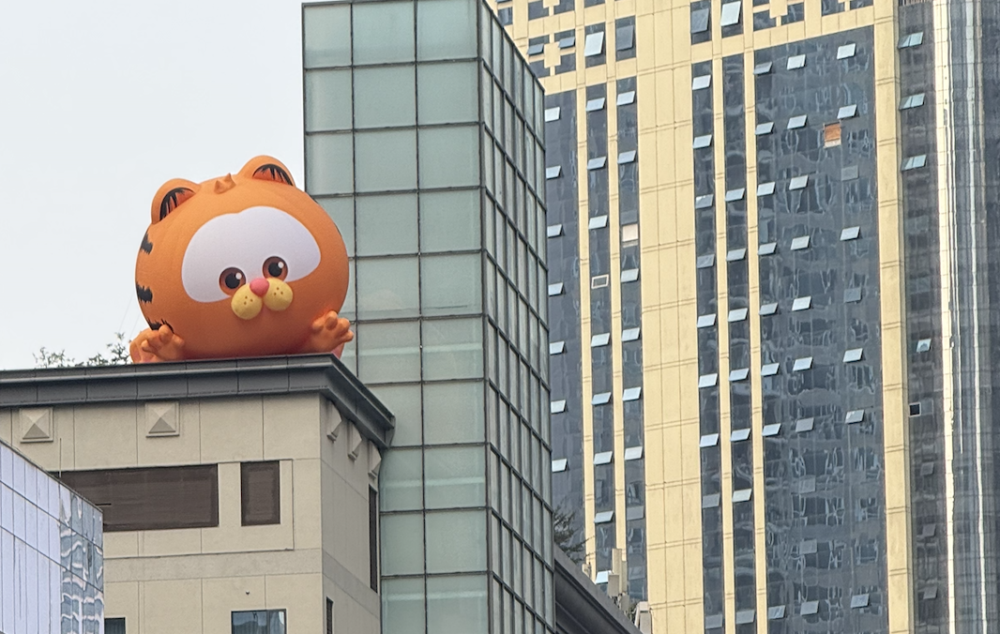

<!--
  GitHub Profile README
  Maintainer: JoK3rLeE
-->

  

  # Jason Jiang Yee
  ### Android Platform • Linux Kernel • Embedded Systems

  **Independent Android developer focused on keeping capable hardware alive through low-level software engineering.**

  

    
    
  

---

## 👨‍💻 About Me

Hi, I'm **Jason**, also known as **[@JoK3rLeE](https://github.com/JoK3rLeE)**.

I work primarily on Android platform development and Linux kernel engineering, with a particular focus on Qualcomm-based Xiaomi devices. My ongoing work revolves around the **Xiaomi Mi 9 (cepheus)** and its **Snapdragon 855 / SM8150** platform.

I enjoy working below the application layer: understanding hardware interfaces, adapting kernel subsystems, maintaining device configurations, debugging platform issues, and bringing newer Android releases to aging hardware.

My approach is engineering-led: investigate the underlying implementation, keep changes traceable, and validate functionality on real hardware wherever possible.

## 🛠️ Technical Focus

| Area | Focus |
|---|---|
| **Linux Kernel** | Qualcomm SM8150, kernel development, subsystem integration, driver work and backports |
| **Android Platform** | Android bring-up, device configuration, framework and hardware integration |
| **Device Trees** | Xiaomi device trees, common platform configuration, product and vendor integration |
| **Kernel Security** | KernelSU Next, SUSFS integration, SELinux policy and security-related changes |
| **Hardware Support** | Touchscreen, fingerprint / FOD, display, charging, NFC and other device interfaces |
| **Display Engineering** | Panel configuration, refresh-rate experiments, HBM and DC-dimming integration |
| **Recovery** | Custom recovery device configuration and maintenance |

## 📱 Main Platform — Xiaomi Mi 9 (cepheus)

The Mi 9 is the primary device behind much of my Android development work.

| Component | Platform |
|---|---|
| Device | Xiaomi Mi 9 — `cepheus` |
| SoC | Qualcomm Snapdragon 855 |
| Platform | Qualcomm SM8150 |
| CPU | Qualcomm Kryo 485 |
| GPU | Adreno 640 |
| Display | 6.39-inch AMOLED, 1080 × 2340 |

### Main Development Repositories

| Project | Description | Branch |
|---|---|---|
| [Linux Kernel — SM8150](https://github.com/JoK3rLeE/android_kernel_xiaomi_sm8150) | Main Mi 9 kernel development tree | `17-ksun` |
| [Mi 9 Device Tree](https://github.com/JoK3rLeE/android_device_xiaomi_cepheus) | Device-specific Android configuration | `17.0` |
| [SM8150 Common Device Tree](https://github.com/JoK3rLeE/device_xiaomi_sm8150-common) | Shared platform configuration | `17.0` |
| [Mi 9 Device Tree (legacy)](https://github.com/JoK3rLeE/device_xiaomi_cepheus/tree/sixteen) | Earlier device configuration line | `sixteen` |
| [Mi 9 Vendor](https://github.com/JoK3rLeE/proprietary_vendor_xiaomi_cepheus) | Proprietary device blobs | See repository |
| [SM8150 Common Vendor](https://github.com/JoK3rLeE/vendor_xiaomi_sm8150-common) | Shared proprietary platform components | See repository |
| [Xiaomi Hardware](https://github.com/JoK3rLeE/hardware_xiaomi) | Xiaomi-specific hardware interfaces and components | `cnb` |
| [Frameworks Native](https://github.com/JoK3rLeE/frameworks_native) | Android native framework work | `17` |

### Kernel Development

My kernel work focuses on maintaining and extending the SM8150 platform, including:

- Kernel maintenance and adaptation for newer Android platform releases.
- Driver and hardware-interface debugging for the Xiaomi Mi 9.
- KernelSU Next and SUSFS-related integration and compatibility work.
- SELinux and platform security policy investigation.
- Display, touchscreen, fingerprint and charging subsystem improvements.
- Evaluating upstream changes, backports and cross-device implementations.

**Kernel source:** [android_kernel_xiaomi_sm8150](https://github.com/JoK3rLeE/android_kernel_xiaomi_sm8150)

> Development status varies by feature and branch. Experimental work should not be assumed to be production-ready.

## 🔬 Other Projects

| Repository | Description |
|---|---|
| [SM8150 Kernel — 5.4](https://github.com/JoK3rLeE/kernel_xiaomi_sm8150-5.4) | Kernel 5.4 platform development and porting work |
| [CAF MSM 5.4](https://github.com/JoK3rLeE/caf_msm-5.4) | Qualcomm CAF kernel source |
| [OrangeFox / Recovery Tree](https://github.com/JoK3rLeE/twrp_cepheus) | Custom recovery device tree for cepheus |
| [AnyKernel3](https://github.com/JoK3rLeE/AnyKernel3) | Kernel packaging and installation tooling |

## 📦 ROM Builds

Some of my device builds and releases are archived on SourceForge:

- **Project Infinity X — Xiaomi Mi 9:** [Download archive](https://sourceforge.net/projects/device-xiaomi-cepheus/files/infinity-x/)
- **Evolution X — Xiaomi Mi 9:** [Download archive](https://sourceforge.net/projects/device-xiaomi-cepheus/files/17.0/)

Build availability and maintenance status are determined by the respective release pages. These links are provided as project history and download references, not as a guarantee of current support.

## 🧰 Tools & Technologies

  
  
  
  
  
  
  
  

## 📊 GitHub Activity

  
  

   

  

## 🤝 Collaboration

I'm interested in collaborating on:

- Android device bring-up and maintenance.
- Qualcomm kernel development and subsystem debugging.
- Device tree, vendor and hardware integration.
- Kernel security and compatibility work.
- Reviving and extending support for older Android devices.

Feel free to explore my repositories, review the code, or open an issue or pull request on the relevant project.

---

  **Thanks for visiting. Build, break, understand, improve.**

  Maintained by Jason Jiang Yee · <a href="https://github.com/JoK3rLeE">@JoK3rLeE</a>

